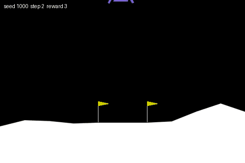
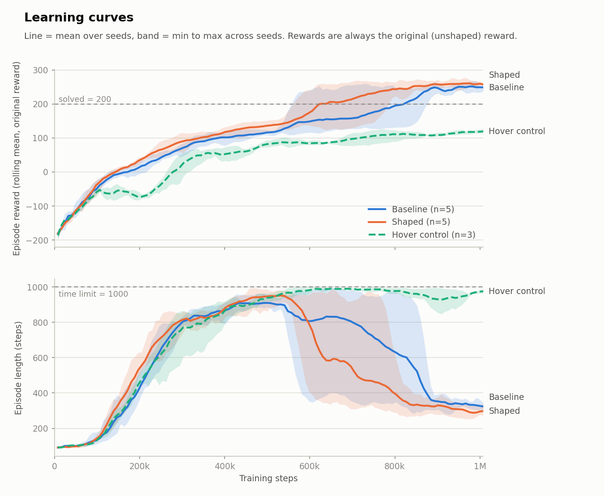
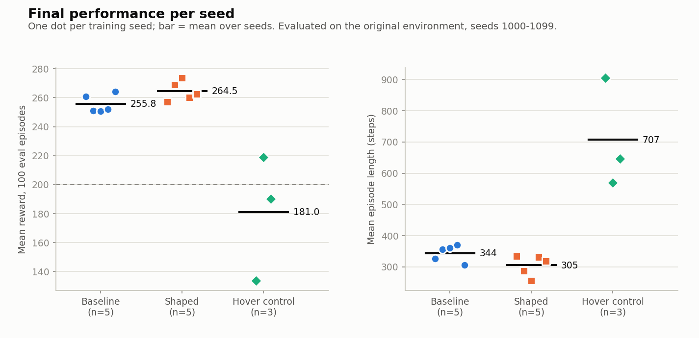

# PPO on LunarLander-v3: baseline vs. shaped reward

Train a PPO agent to land a lunar module (Gymnasium `LunarLander-v3`, discrete actions) on a **CPU-only laptop**, then test whether a hand-written reward-shaping term changes how learning goes, across multiple seeds, with a deliberately bad reward as a negative control.

<p align="center">
  
  
</p>
<p align="center"><em>Same start (seed 1000). Left: after 400k steps (reward 162, 670 steps, lands left of the pad). Right: after 1M steps (reward 281, 328 steps, on the pad).</em></p>

## Results

All numbers come from `results/summary_per_run.csv` and `results/summary_stats.json`, generated by `plots.py` from the training logs and `evaluate.py` output. Every model is evaluated the same way: **100 episodes, seeds 1000-1099 (never used for training), deterministic actions, the original unmodified environment.**

| Agent | Mean eval reward | Success (reward >= 200) |
|---|---|---|
| Random actions | -200.8 +/- 11.0 (s.e.m.) | 0% |
| **Baseline PPO**, 5 seeds | **255.8** (sd 6.2 across seeds) | 96-100% per seed |
| **Shaped-reward PPO**, 5 seeds | **264.5** (sd 6.8 across seeds) | 96-100% per seed |
| Hover-bonus control, 3 seeds | 181.0 (133.8 / 219.1 / 190.2) | 17% / 84% / 60% |

**1. PPO solves the task reliably.** All 10 baseline and shaped runs average above 250 after 1M steps. It is not a one-seed fluke.

**2. The shaped reward looks slightly better, but this is not established.** Shaped minus baseline, 5 seeds per side:

| Metric | Baseline | Shaped | Difference | Exact permutation p |
|---|---|---|---|---|
| Final eval reward | 255.8 | 264.5 | +8.7 | 0.071 |
| Episode length (steps) | 344.0 | 305.4 | -38.6 | 0.079 |
| Steps until rolling mean first reaches 200 | 768k | 662k | -106k | 0.159 |

All three point the same way, and none passes the usual p < 0.05 bar. With 5 seeds I would call this *suggestive*. Three metrics were tested without multiple-comparison correction, so treat the p-values as exploratory.

**3. A flat per-step bonus hurts.** The negative control (+0.5 per step, not potential-based) scored worse than every baseline seed, and episodes ran 570-906 steps, against 306-371 for the baseline. The damage varied by seed: seed 0 hovered until the time limit in 79% of evaluation episodes, while seed 1 mostly landed but slowly.

<picture>
  <source media="(prefers-color-scheme: dark)" srcset="results/learning_curves_dark.png">
  
</picture>

Both baseline and shaped spend a long stretch (roughly 300k-600k steps) with episodes near 900 steps long and reward around 100-150, before dropping to about 300 steps. Shaped leaves that stretch earlier on average, but the seed-to-seed bands overlap heavily.

<picture>
  <source media="(prefers-color-scheme: dark)" srcset="results/final_performance_dark.png">
  
</picture>

## What I learned

- **Reward alone hid what the agent was doing.** At 400k steps the training reward was positive, which I first read as "hovering". Measuring the 400k checkpoint over 20 episodes showed something different: 12 landed, 5 crashed, 3 timed out, all ended left of the pad, and landings took 600-840 steps with heavy engine use. Episode length plus a direct look at behavior told me more than the reward curve.
- **Potential-based shaping changes when feedback arrives, not what is optimal.** `check_wrappers.py` verifies this numerically: the shaping terms telescope to the expected value (error ~1e-13), and the logged reward is always the original one.
- **A bad bonus is not always catastrophic, which makes it easy to miss.** One of three control seeds still learned to land (slowly). A single seed would have given a misleading answer in either direction.
- **Estimates were wrong more than once.** My training-time guess was off by about 1.6x on the first run (6-7 min predicted, 10.7 min actual), and my first "hover" explanation was wrong. Measuring beat guessing every time.

## Limitations

- **5 seeds per condition.** Detecting a ~9-point reward difference reliably would need roughly 15-20 seeds (a rough estimate from these runs, not a formal power analysis).
- **One shaping setting** (K = 50, y0 = 0.5), untuned. "This setting showed a small, uncertain benefit" is the most that can be said.
- **No hyperparameter tuning** for either condition: commonly used PPO values, 1M steps.
- Training-curve rewards use the *sampled* policy; final evaluations use the *deterministic* policy, so they are not directly comparable.
- "Steps to 200" has a resolution of 8,192 steps and uses a 100-episode rolling mean.
- Hover control: 3 seeds, no significance test.
- Developed on one machine (Ryzen 5 5600H, 7.4 GB RAM, no GPU).

## Method

- **Algorithm:** Stable-Baselines3 PPO, `MlpPolicy` (2x64 actor and critic), 8 parallel environments, CPU.
- **Hyperparameters:** `n_steps=1024`, `batch_size=64`, `n_epochs=4`, `gamma=0.999`, `gae_lambda=0.98`, `ent_coef=0.01`, `learning_rate=3e-4`, `clip_range=0.2`; 1,000,000 steps per run, about 9-19 minutes each.
- **Shaped reward** (`wrappers.py`): adds `F = gamma*Phi(s') - Phi(s)` with `Phi(s) = -50 * w(y) * (vx^2 + vy^2)`, where `w(y)` rises from 0 (height >= 0.5) to 1 (ground). The potential of a terminal state is 0 and `gamma` matches PPO's, which is what guarantees the optimal policy is unchanged.
- **Negative control:** `HoverBonusWrapper` adds a flat +0.5 per step.
- **Fair comparison:** `Monitor` sits inside the reward wrapper, so logged episode rewards, and all evaluations, use the original reward.

## Reproduce

Tested on Ubuntu 22.04 (WSL2), Python 3.10. Box2D is built from source, so install a compiler and Python headers first (`sudo apt install build-essential python3-dev`), and install `swig` **before** the rest:

```bash
git clone https://github.com/raneaditya012-cmd/RocketLandingRHL.git && cd RocketLandingRHL
python3 -m venv .venv && source .venv/bin/activate   # or: pip install virtualenv && virtualenv .venv
pip install swig
pip install -r requirements.txt                        # CPU-only PyTorch via the extra index in the file
python smoke_test.py                                   # environment check
```

```bash
python check_wrappers.py                                          # verify the reward wrappers
python evaluate.py --model models/baseline_seed0.zip --out results/eval_seed0.json
python demo.py --model models/baseline_seed0.zip --gif results/my_landing.gif
python demo.py --model models/baseline_seed0.zip --live           # live view at http://localhost:8000
python train.py --seed 0 --run-name baseline_seed0                # train one run (add --shaped potential)
bash run_experiment.sh                                            # all 12 runs, ~2-2.5 h
python plots.py                                                   # figures, tables, statistics
```

`--live` streams frames to a browser, because the Linux window system on my machine did not draw pygame windows (WSLg). Native Windows was not an option here: Smart App Control blocked Box2D's unsigned binary.

## Files

| File | Purpose |
|---|---|
| `train.py` | Train PPO (`--seed`, `--timesteps`, `--shaped none/potential/hover`); logs CSV and TensorBoard, saves checkpoints |
| `evaluate.py` | The fixed 100-episode evaluation protocol; writes JSON |
| `wrappers.py` | Shaped-reward wrapper and the hover-bonus control |
| `check_wrappers.py` | Numerical checks for the wrappers |
| `demo.py`, `live_view.py` | GIF recorder and browser live viewer |
| `plots.py` | Learning curves, final performance, sample efficiency, permutation tests |
| `run_experiment.sh` | Runs the full 12-run experiment sequentially (resumable) |
| `baseline_random.py`, `smoke_test.py` | Random-agent baseline; environment check |
| `PLAN.md` | The original plan, with a log of deviations |
| `models/baseline_seed0.zip` | Pretrained baseline model (seed 0) |
